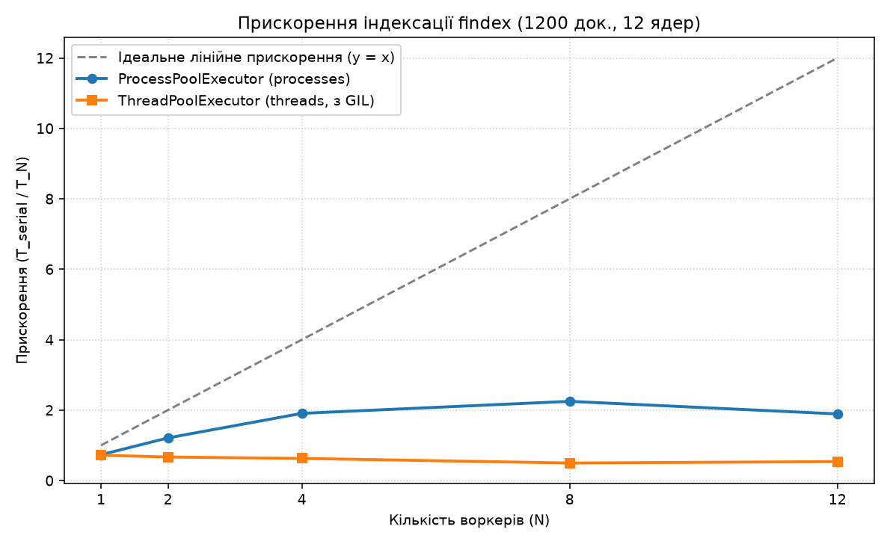

# findex — пошукова система з паралельною індексацією

Навчальна пошукова система на Python із потоковим токенізатором, інвертованим індексом (`Mapping`), булевими та фразовими запитами, ранжуванням **BM25 / TF-IDF**, бінарною серіалізацією (`FIDXBIN1`) та паралельною побудовою індексу.

## Встановлення та запуск

```bash
uv sync
uv run findex index data/corpus --out index.bin --positions
uv run findex search index.bin '"white whale" AND harpoon' --scorer bm25 --top 5
```

### Параметри індексації (Лабораторна робота №5)

Архітектуру побудови індексу розділено на дві чисті функції:
* `build_partial(paths, corpus_root, start_doc_id=..., include_positions=...)` — модуль-рівнева функція, що приймає лише шляхи файлів та виділений діапазон `doc_id` (безпечна для серіалізації `pickle` і запуску процесів методом `spawn` у Windows/macOS).
* `merge(partials, corpus_root=...)` — об'єднує впорядковані часткові індекси в єдиний `Index` зі збереженням щільної нумерації `0..N-1`.

```bash
# Типовий режим (ProcessPoolExecutor, кількість воркерів = os.cpu_count())
uv run findex index data/corpus --executor processes --workers 8 --positions

# Послідовний або багатопотоковий режими
uv run findex index data/corpus --executor serial
uv run findex index data/corpus --executor threads --workers 4
```

---

## Бенчмарк паралельної індексації (Лаб 5)

### Апаратне та програмне середовище
* **Процесор:** `12th Gen Intel(R) Core(TM) i5-12450H` (гібридна архітектура Alder Lake: **8 фізичних ядер** — 4 продуктивних P-cores + 4 енергоефективних E-cores, **12 логічних потоків**, `os.cpu_count() = 12`).
* **ОС:** Windows 64-bit (метод створення процесів: `spawn`).
* **Інтерпретатори:** `CPython 3.12.5` (`sys._is_gil_enabled() == True`) та `CPython 3.13.18 experimental free-threading build` (`sys._is_gil_enabled() == False`).
* **Тестовий корпус:** `data/corpus_bench` — **1 200 документів** (`64.17 МБ`), індексація з позиціями токенів (`--positions`).
* **Методика вимірювання:** кожна конфігурація запускалася щонайменше 3 рази після прогріву дискового кешу ОС; у таблицю занесено **медіану**.

### Зведена таблиця результатів

| Виконавець | Збірка Python (`GIL`) | Воркери | Wall time (с) | CPU time (с) | Пік RSS (МБ) | Merge (с) | Прискорення |
| :--- | :--- | ---: | ---: | ---: | ---: | ---: | ---: |
| `serial` | 3.12.5 (`True`) | 1 | 9.554 | 9.219 | 733.0 | 0.0021 | 1.00x |
| `threads` | 3.12.5 (`True`) | 1 | 13.258 | 12.688 | 733.5 | 0.0039 | 0.72x |
| `threads` | 3.12.5 (`True`) | 2 | 14.330 | 14.047 | 734.8 | 0.0028 | 0.67x |
| `threads` | 3.12.5 (`True`) | 4 | 15.225 | 14.969 | 736.0 | 0.0048 | 0.63x |
| `threads` | 3.12.5 (`True`) | 8 | 19.224 | 19.141 | 737.3 | 0.0061 | 0.50x |
| `threads` | 3.12.5 (`True`) | 12 | 17.768 | 18.047 | 738.0 | 0.0073 | 0.54x |
| `processes` | 3.12.5 (`True`) | 1 | 13.052 | 12.672 | 738.0 | 0.0043 | 0.73x |
| `processes` | 3.12.5 (`True`) | 2 | 7.896 | 1.078 | 753.1 | 0.0035 | 1.21x |
| `processes` | 3.12.5 (`True`) | 4 | 5.011 | 0.984 | 760.1 | 0.0031 | 1.91x |
| `processes` | 3.12.5 (`True`) | 8 | **4.249** | 1.016 | 760.1 | 0.0030 | **2.25x** |
| `processes` | 3.12.5 (`True`) | 12 | 5.053 | 0.969 | 760.1 | 0.0032 | 1.89x |
| `threads` (no-GIL) | 3.13.18t (`False`) | 1 | 20.688 | — | — | — | 0.37x (0.46x*) |
| `threads` (no-GIL) | 3.13.18t (`False`) | 2 | 7.549 | — | — | — | 1.01x (1.27x*) |
| `threads` (no-GIL) | 3.13.18t (`False`) | 4 | 4.269 | — | — | — | 1.78x (2.24x*) |
| `threads` (no-GIL) | 3.13.18t (`False`) | 8 | 3.929 | — | — | — | 1.94x (2.43x*) |
| `threads` (no-GIL) | 3.13.18t (`False`) | 12 | **2.591** | — | — | — | **2.94x (3.69x\*)** |

> \* Для збірки `Python 3.13.18t` (`sys._is_gil_enabled() -> False`) у дужках наведено прискорення відносно базового послідовного прогону `Python 3.12.5 serial` (`9.554 с`), а перед дужками — відносно послідовного прогону `3.13.18t` (`7.62 с`).

### Графік прискорення від кількості воркерів



---

## Конкурентність, GIL та аналіз результатів

### 1. Чому потоки під GIL не прискорили індексацію
Побудова інвертованого індексу — задача, обмежена процесором (**CPU-bound**): основний час витрачається на Unicode-нормалізацію (`unicodedata.normalize`), регулярні вирази, підрахунок частот (`Counter`) і формування списків `Posting`. У стандартному CPython 3.12 глобальне блокування інтерпретатора (**GIL**) дозволяє виконувати байт-код Python лише одному потоку в кожен момент часу. Коли 4–12 потоків одночасно виконують чистий Python-код, вони не працюють паралельно на різних ядрах, а постійно конкурують за захоплення GIL. Додаткові системні виклики на перемикання контексту та промахи кешу процесора призвели до анти-масштабування: час зріс із `9.554 с` (`serial`) до `19.224 с` (`0.50x` на 8 потоках).

### 2. Чому процеси прискорили індексацію і чим це оплачено
`ProcessPoolExecutor` створює окремі процеси ОС, кожен із яких має власний екземпляр інтерпретатора CPython, власну купу пам'яті та незалежний GIL. Завдяки цьому 8 процесів реально виконують токенізацію на 8 фізичних ядрах i5-12450H паралельно, скоротивши реальний час очікування (**wall time**) з `9.554 с` до `4.249 с` (**2.25x**).

Цей виграш має три конкретні статті витрат:
1. **Накладні витрати `spawn` та `pickle`:** на Windows кожен дочірній процес запускається з нуля (`spawn`), імпортує модулі проєкту, а готовий `PartialIndex` (словник із мільйонами об'єктів `Posting` і кортежів позицій) серіалізується через `pickle` у воркері й десеріалізується в головному процесі. На 1 воркері (`processes, N=1`) це додає `+3.5 с` чистого оверхеду (`13.052 с` проти `9.554 с`).
2. **Різниця між `CPU time` та `wall time`:** у таблиці для `processes (N=8)` значення `CPU time` становить лише `1.016 с` при `wall time = 4.249 с`. Функція `time.process_time()` вимірює процесорний час **лише батьківського процесу** (який переважно чекає на I/O каналів IPC, розпаковує `pickle` та виконує `merge`), тоді як основна обчислювальна робота розподілена між дочірніми процесами.
3. **Пікове споживання пам'яті (`RSS`):** батьківський процес утримує одночасно прийняті буфери десеріалізації від усіх воркерів і об'єднаний індекс, через що пік `RSS` зростає з `733.0 МБ` (`serial`) до `760.1 МБ` (`processes`), не враховуючи пам'ять самих дочірніх процесів у системі. Крім того, при збільшенні воркерів із 8 до 12 (`5.053 с`) виникає конкуренція гіперпотоків (Hyper-Threading) за спільні виконавчі блоки фізичних ядер та вищі витрати на `spawn`/`pickle`.

### 3. Де в часі `merge` проявляється закон Амдала
За законом Амдала максимальне прискорення обмежене послідовною часткою програми $s$:

$$S(N) = \frac{1}{s + \frac{1 - s}{N}}$$

У `findex` паралельною частиною ($1 - s$) є `build_partial`, а послідовною ($s$) — розбиття шляхів, міжпроцесна передача (`pickle`) та фінальне злиття `merge(partials)`. Сам етап `merge` займає лише `0.0030–0.0073 с` (менше 0.1% від загального часу), оскільки постінги в межах кожного діапазону `doc_id` уже відсортовані й об'єднуються простим `list.extend`. Проте разом із десеріалізацією `pickle` у головному процесі (`~1.0 с` CPU time) та запуском процесів `spawn` послідовна фаза становить близько 25–30% часу виконання при великому $N$, що обмежує реальний пік прискорення на рівні `2.25x` замість ідеальних `8.0x`.

### 4. Що змінилося на Python `3.13t` без GIL та гонитва даних (Data Race)
На експериментальній збірці `Python 3.13.18t` (`sys._is_gil_enabled() -> False`) глобальне блокування вимкнене, тому потоки `ThreadPoolExecutor` починають виконувати байт-код паралельно на всіх ядрах процесора, але **без витрат на `spawn` і копіювання даних через `pickle`** (усі потоки працюють у спільному адресному просторі). Як наслідок, на 12 потоках час впав до **`2.591 с`** — це у **3.69 раза** швидше за `Python 3.12.5 serial` (`9.554 с`) і на **39% швидше** за найкращий результат `ProcessPoolExecutor` (`4.249 с`).

**Гонитва даних (Data Race) і її виправлення:**
GIL захищав лише внутрішні структури самого інтерпретатора (лічильники посилань, внутрішній стан `dict`/`list`), але ніколи не гарантував атомарності складених операцій рівня програми (наприклад, `read-modify-write`). Без GIL ця проблема проявляється миттєво. У скрипті `scripts/gil_experiment.py` 8 потоків одночасно виконували по 50 000 інкрементів лічильника у спільному словнику `shared_counts["python"] = shared_counts["python"] + 1`:
* **Очікуваний результат:** `400 000`
* **Без синхронізації (`Data Race`):** `62 313` (**втрачено 337 687 оновлень**, або 84.4%, через одночасне читання застарілого значення різними потоками).
* **Фікс:**
  1. У продуктивному коді `findex` кожен воркер `build_partial` будує **ізольований локальний словник** постінгів для свого діапазону `doc_id`, а об'єднання відбувається в одному потоці у функції `merge` (патерн *share-nothing / map-reduce*, без блокувань на гарячому шляху).
  2. Для спільних структур у `gil_experiment.py` критичну секцію захищено примітивом `threading.Lock()`, що відновило точне значення `400 000`.

### 5. Дослід на I/O-bound задачі (читання файлів)
На противагу CPU-індексації, при простому читанні всіх 1 200 файлів корпусу (`64.17 МБ`) з диска навіть стандартний `ThreadPoolExecutor` із увімкненим GIL дає відчутне прискорення: час зменшився з `0.4183 с` (`serial`) до `0.2142 с` (`threads, N=12`, прискорення **1.95x**), оскільки системні виклики читання I/O звільняють GIL під час очікування відповіді від файлової системи та дозволяють черзі запитів до SSD оброблятися паралельно.

---

## Reflection (питання для захисту)

1. **Чому `build_partial` приймає саме список `Path`, а не вже прочитані тексти документів `list[str]`?**
   Якби головний процес спочатку читав усі файли з диска в пам'ять, він би перетворився на вузьке місце по I/O та RAM, а потім змушений був би серіалізувати десятки мегабайт текстів через `pickle` у канали IPC для кожного воркера. Передача лише компактних шляхів `Path` дозволяє кожному процесу самостійно читати й токенізувати свою порцію файлів паралельно.
2. **Чому на Windows для `ProcessPoolExecutor` критично, щоб `build_partial` була функцією рівня модуля, а не вкладеною функцією чи `lambda`?**
   На Windows відсутній системний виклик `fork()`, тому процеси створюються методом `spawn`: новий процес імпортує модуль з нуля, а `pickle` передає функцію за її повним кваліфікованим ім'ям (`findex.index.build_partial`). Вкладені функції або `lambda` не мають публічного імені на рівні модуля, тому `pickle.PicklingError` миттєво зупинить запуск.
3. **Як у `findex` гарантується відсутність колізій `doc_id` між паралельними воркерами та збереження порядку документів?**
   Перед запуском воркерів відсортований список шляхів розбивається на суміжні діапазони `(start_doc_id, chunk_paths)`, а результати збираються у масив `ordered[chunk_idx]` за індексом чанка (а не в порядку завершення `as_completed`). Якщо серед файлів трапиться порожній документ і виникне прогалина в нумерації, функція `merge` автоматично переіндексовує `doc_id` у щільний діапазон `0..N-1`.